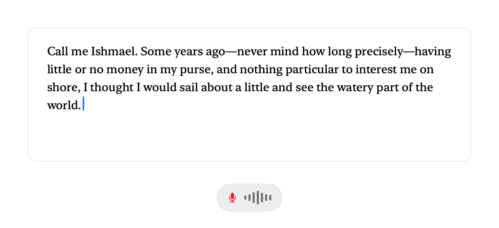
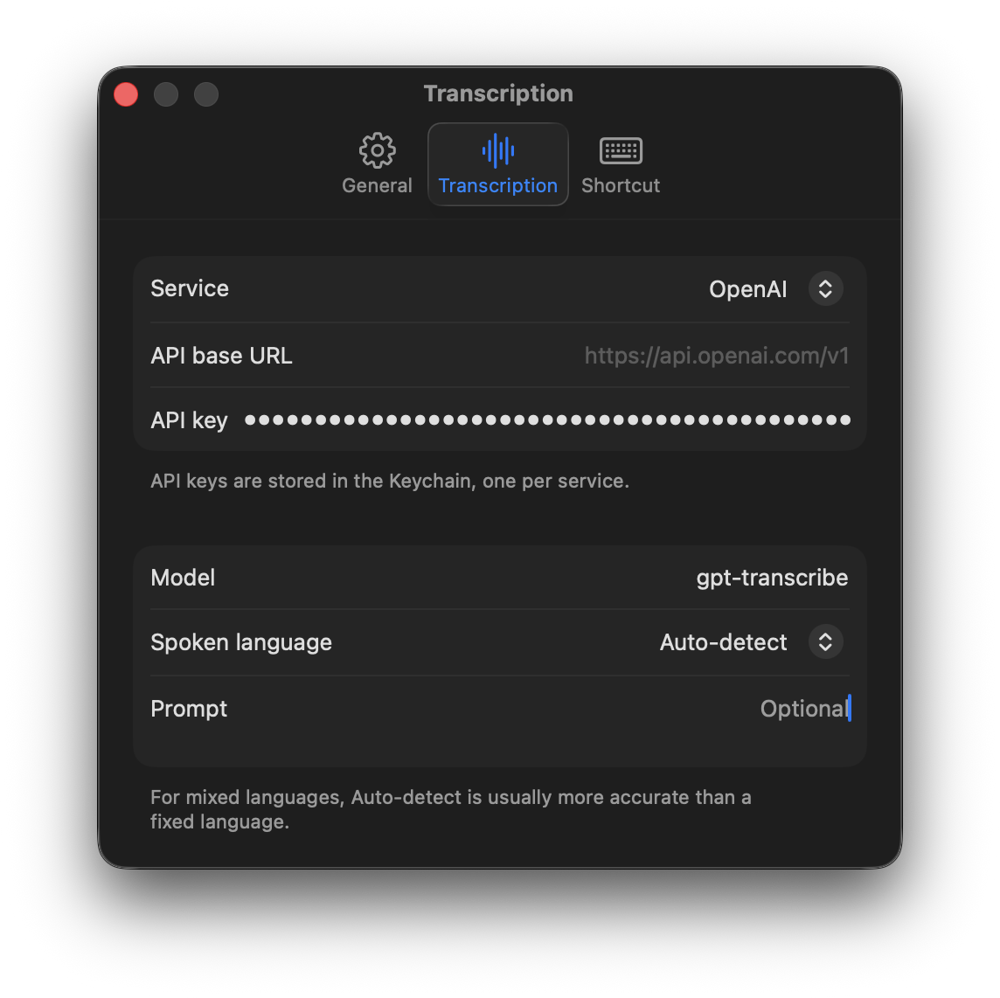
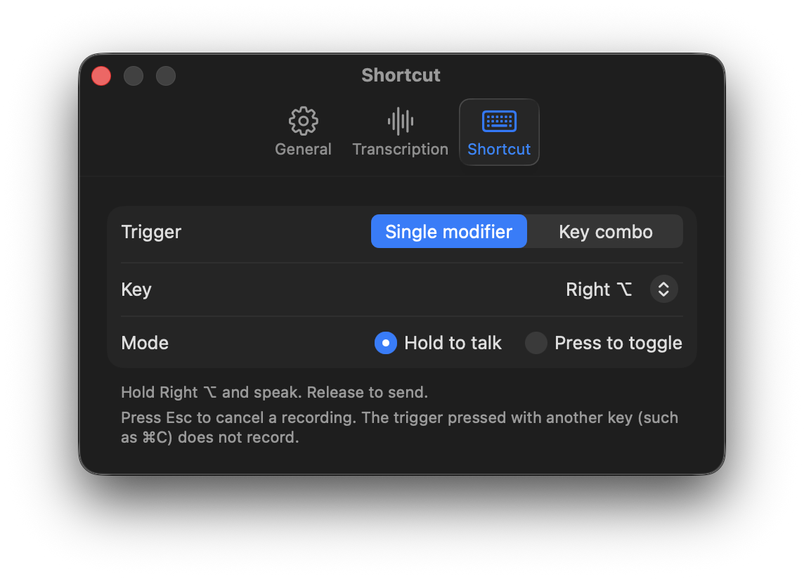

<p align="center">
  
</p>

<h1 align="center">Dictate</h1>

<p align="center">
  A tiny macOS menu bar app: hold a key, speak, and the text appears wherever your cursor is.<br>
  Bring your own OpenAI-compatible API key. About 2,000 lines of Swift, no dependencies.
</p>

<p align="center">
  <picture>
    <source media="(prefers-color-scheme: dark)" srcset="docs/images/scene-dark.png">
    
  </picture>
</p>

<p align="center"><a href="#繁體中文">繁體中文說明</a></p>

---

## Features

- **Push to talk, anywhere.** Hold right ⌘ (default), speak, release. The transcript is pasted into the focused text field of any app, and your clipboard is restored afterwards.
- **Your trigger.** Any single modifier (left/right ⌘ ⌥ ⌃ ⇧, or Fn/🌐), or a recorded key combo such as ⌥Space. Hold-to-talk or tap-to-toggle. Esc cancels.
- **Any OpenAI-compatible endpoint.** Presets for OpenAI (`gpt-transcribe`) and OpenRouter (`openai/gpt-transcribe`), or set your own base URL and model (Groq, a local server, …). It calls `POST {base}/audio/transcriptions`.
- **Keys in the Keychain.** One key per API host, so switching providers keeps both.
- **Traditional Chinese friendly.** Optional Simplified → Traditional (Taiwan) conversion with [OpenCC](https://github.com/BYVoid/OpenCC) `s2twp`, leaving code and URLs untouched.
- **Native and quiet.** Menu bar icon, a small vibrancy HUD with a live level meter, toolbar-style settings, optional system sounds, launch at login.
- **English or 繁體中文 UI.** Follows the system language, or pick one in Settings › General › Language. The change applies right away.
- **Recent transcripts.** The last 10 are in the menu (⌘1–⌘9 to copy). Memory only; nothing is written to disk.

<p align="center">
  
  
</p>

Dictate does no AI rewriting, no local models, and no accounts. Audio goes to the endpoint you configure and nowhere else.

## Requirements

- macOS 14 or later
- Swift 6.2 (Xcode or Command Line Tools)
- An API key for OpenAI, OpenRouter, or another OpenAI-compatible transcription endpoint
- Optional: `brew install opencc` for Simplified → Traditional conversion

## Build and run

```sh
git clone https://github.com/minchenlee/dictate.git
cd dictate
scripts/bundle.sh          # builds build/Dictate.app
open build/Dictate.app
```

`bundle.sh` signs with the first "Apple Development" identity in your keychain, if any, otherwise ad-hoc. A stable identity matters: with ad-hoc signing every rebuild gets a new code identity, macOS silently stops honouring the Accessibility grant, and pasting stops working. Override with `SIGN_ID="<identity>"`, or force ad-hoc with `SIGN_ID=-`.

To keep it around, copy `Dictate.app` to `/Applications` before you turn on "Launch at login".

## Permissions

| Permission | Why |
|---|---|
| Microphone | Record your voice. |
| Accessibility | Detect a single-modifier trigger, and post ⌘V to paste. |

Without Accessibility the transcript stays on the clipboard and Dictate tells you to press ⌘V yourself.

## How it works

1. The trigger starts `AVAudioRecorder` (16 kHz mono AAC).
2. On release, very short or silent takes are dropped. Transcription models tend to invent text for silence.
3. The audio is sent as `multipart/form-data` to `{base}/audio/transcriptions`.
4. If enabled and OpenCC is installed, the text is converted to Traditional Chinese.
5. The text is placed on the pasteboard (marked transient for clipboard managers), ⌘V is posted, and the previous pasteboard is restored.

If you start a new take while the previous one is still transcribing, results are pasted in the order you spoke.

## Development

```sh
swift build
swift run DictateChecks          # unit tests (swift-testing), headless
swift scripts/make-icon.swift    # regenerate Resources/AppIcon-1024.png
DICTATE_SCREENSHOTS=docs/images build/Dictate.app/Contents/MacOS/Dictate   # re-render the HUD and scene images offscreen
```

Tests run as an executable because `swift test` under Command Line Tools 6.2 exits without running swift-testing suites.

| Path | Contents |
|---|---|
| `Sources/DictateCore` | Pure logic: hotkey state machine, triggers, request building and parsing, Chinese conversion, settings, history. |
| `Sources/Dictate` | AppKit/SwiftUI: menu bar, HUD, recorder, global hotkeys, paste, Keychain, settings window. |
| `Resources/Localization` | UI strings. Keys are the English text; `zh-Hant.lproj` holds the translations. A check fails when a key is untranslated. |
| `Tests/DictateCoreTests` | swift-testing suites, run by `DictateChecks`. |

## Alternatives

Dictation apps are a crowded space. If you want local models, AI cleanup, or cross-platform support, look at [Handy](https://github.com/cjpais/Handy), [VoiceInk](https://github.com/Beingpax/VoiceInk), [OpenWhispr](https://github.com/OpenWhispr/openwhispr), or [FreeFlow](https://github.com/zachlatta/freeflow). Dictate is the small, cloud-only, read-it-in-an-afternoon option.

## License

[MIT](LICENSE)

---

## 繁體中文

Dictate 是一個很小的 macOS 選單列語音輸入 app：按住右 ⌘ 說話，放開後文字就貼到游標所在的輸入框。

- 觸發鍵可以選任一修飾鍵（左右 ⌘⌥⌃⇧、Fn），或錄一組組合鍵（例如 ⌥Space）。模式有「按住說話」和「按一下切換」。按 Esc 取消。
- 轉錄走任何 OpenAI 相容的 API。內建 OpenAI（`gpt-transcribe`）和 OpenRouter 預設，也可以自訂 base URL。
- API key 存在「鑰匙圈」。
- 有安裝 `opencc` 時，會把簡體轉成台灣繁體用語，程式碼和網址不轉。
- 選單列保留最近 10 筆轉錄，只放在記憶體。
- 介面有英文和繁體中文。預設跟隨系統語言，也可以在「設定 › 一般 › 語言」切換，立即生效。
- 需要「麥克風」和「輔助使用」兩個權限。

建置：`scripts/bundle.sh`，然後 `open build/Dictate.app`。
